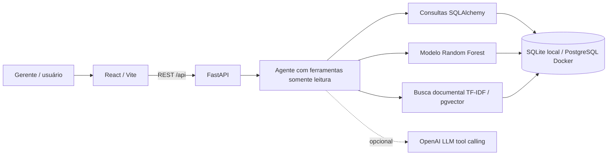

# Arquitetura e decisões técnicas

## Visão dos componentes

## Decisões

**Banco.** SQLAlchemy permite demonstrar o projeto sem infraestrutura usando SQLite. No Docker, o padrão é PostgreSQL em uma imagem compatível com pgvector, com volume persistente. A semente só cria pedidos quando a tabela está vazia, evitando duplicatas em reinicializações.

**RAG.** Documento vira trecho com título, seção, arquivo de origem e texto persistidos em `knowledge_documents`. A busca por TF-IDF usa n-gramas e normalização de acentos; funciona 100% offline. Busca por embeddings é opt-in e depende de chave OpenAI/PostgreSQL. Em caso de erro de embedding, volta para TF-IDF. O UI sempre exibe as fontes.

**Agente.** Em modo local, expressões em português selecionam ferramentas de leitura e um renderizador determinístico compõe a resposta. É uma alternativa honesta para desenvolvimento sem credenciais: não se apresenta como modelo generativo. Com uma chave OpenAI, o LLM pode chamar ferramentas declaradas por JSON Schema, com uma allowlist. O modelo não recebe acesso livre a SQL nem permissões para executar SQL arbitrário. Falhas do LLM degradam para o modo local.

**Previsão.** Para cada produto, o conjunto de atributos contém dia da semana, fim de semana, índice temporal, última venda, venda do mesmo dia da semana anterior e médias móveis de 7 e 14 dias. O *holdout* usa os últimos 21 dias. Treina Random Forest sem embaralhar e compara uma baseline de dia da semana anterior. A projeção de 7 dias é recursiva; MAE/WAPE divulgados referem-se a previsões de um passo no teste e não são garantia de erro dos sete dias futuros.

**Granularidade.** A previsão soma unidades de `OrderItem.quantity`; pedidos são entidades diferentes. Produtos representam receitas físicas mas não há fichas técnicas de ingredientes. Assim, o app não estima quilos de carne ou unidades de embalagem necessárias.

**Observabilidade e testes.** `pytest` usa DB isolado. `eval/agent_cases.json` contém 50 perguntas pré-definidas. O script de avaliação calcula exatidão do roteamento, recall de ferramentas esperadas e checagem pontual de valores conhecidos. Não confundir esse teste com um verificador genérico de alucinações.

**UI/UX.** React, Vite, Recharts, Lucide e CSS customizado. Navegação em cinco seções, feedback de loading/erro, estados de vazio, tool chips, fontes verificáveis e layouts responsivos.

## Fluxo do copiloto

1. Frontend envia a mensagem a `POST /api/chat`.
2. O backend escolhe modo local ou LLM (chave configurada + modo auto).
3. As ferramentas consultam apenas funções Python controladas; nenhuma consulta SQL é composta diretamente pelo LLM.
4. O backend retorna respostas + resultados estruturados das ferramentas + fontes + modo.
5. A UI mostra a resposta e o conjunto de ferramentas utilizadas, e oferece o detalhe da fonte documental.

## Fluxo da previsão

1. SQL agrega vendas diárias por produto e completa dias sem venda com zero.
2. Features usam somente vendas anteriores à data prevista.
3. Treino/teste cronológico em 21 dias finais.
4. Gera medidas MAE e WAPE comparáveis com baseline.
5. Reajusta o modelo com todo histórico disponível e projeta recursivamente próximos 7 dias.

## Riscos / backlog priorizado

P0 para produção: login e RBAC, multiempresa, integração POS confiável, trilha de auditoria, segurança de upload e dados, HTTPS/gestão de segredos, backup/restore, limites de custo da OpenAI.

P1: importação CSV, estoque e fichas técnicas de ingredientes, promoções e feriados nos atributos de previsão, backtest multi-horizonte, alertas de ruptura e avaliação do próprio LLM com anotação humana.

P2: LangGraph somente se surgirem fluxos multi-etapa com estado ou aprovações; não foi incluído apenas para inflar a stack.
